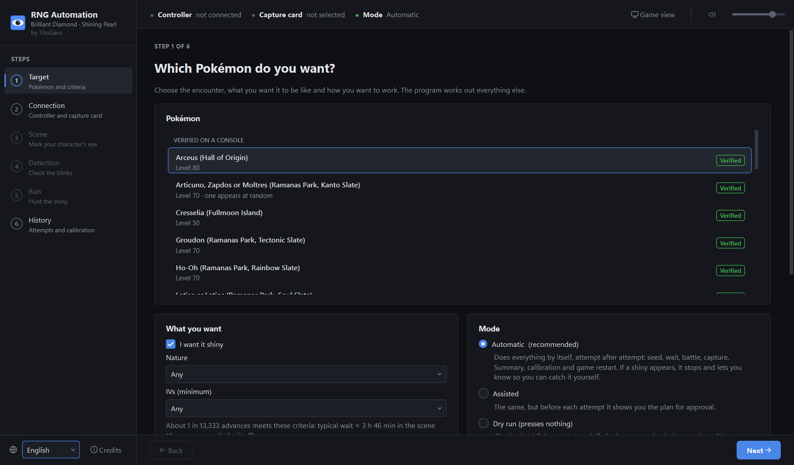

# RNG Automation for Pokémon Brilliant Diamond and Shining Pearl

By **TitoGaro** · [Español](README.md)

[](https://buymeacoffee.com/titogaro)

A Windows desktop app that does blink RNG manipulation of static legendary encounters in *Pokémon Brilliant
Diamond* and *Shining Pearl* from start to finish. It reads the game through a capture card and presses
the buttons with an ESP32 that acts as a controller.



For every attempt, the program:

1. Watches your character blink and works out the game's random number generator state (Xorshift128).
2. Finds the next advance that gives the Pokémon you asked for (shiny, nature, IVs).
3. If the wait is long, uses the Pokédex to move the RNG forward faster, then checks where it landed.
4. Presses the buttons at the right moment and walks up to the legendary.
5. Checks whether the Pokémon is shiny. If it is, it stops and leaves the catch to you. If it is not, it
   catches it, reads its Summary, learns from the result and restarts the game for another attempt.

It does not modify the game or the console. The console only sees a controller.

## Supported encounters

| Encounter | Tested on a real console |
|---|---|
| Regice, Regirock or Registeel (Ramanas Park, Discovery Slate) | Yes |
| Raikou, Entei or Suicune (Ramanas Park, Johto Slate) | Yes |
| Articuno, Zapdos or Moltres (Ramanas Park, Kanto Slate) | Yes |
| Latias or Latios (Ramanas Park, Soul Slate) | Yes |
| Groudon, Kyogre, Ho-Oh, Lugia, Mewtwo, Rayquaza (Ramanas Park) | Yes |
| Regigigas (Snowpoint Temple) | Yes |
| Cresselia (Fullmoon Island) | Yes |
| Arceus (Hall of Origin) | Yes |
| Dialga, Palkia (Spear Pillar), Giratina, Heatran, Darkrai, Shaymin, Azelf, Uxie | Not yet |

The app lists the tested ones first. Untested encounters use the same engine and are marked as such: expect
to adjust something the first time.

## What you need

- A Windows 10 or 11 PC with [Python](https://www.python.org/downloads/) 3.12 or later.
- A Nintendo Switch with *Brilliant Diamond* or *Shining Pearl*.
- An ESP32 board flashed with the **PABotBase2** firmware from
  [Pokémon Automation](https://github.com/PokemonAutomation). Follow their
  [controller list and setup guides](https://pokemonautomation.github.io/ControllerList.html) (the
  "ESP32" option) to choose the board, flash it and pair it with the Switch. The app has been tested with
  the plain ESP32; it also accepts an ESP32-S3, untested. The firmware is not included here, and its license
  allows non-commercial use only.
- A USB capture card (1080p recommended). The app shows the game picture and plays its sound, so you do not
  need any other program. Close any other program that is using the capture card.

## Download

1. Download the zip of the [latest release](https://github.com/TitoGaro/BlinkRNG-Automation/releases/latest) (under **Assets**).
2. Unzip it anywhere and open **`BlinkRNG-Automation.exe`**. You do not need to install Python.
3. The first time, Windows may warn with "Windows protected your PC" because the program is not signed: click
   **More info → Run anyway**.

To run it from source, see [Development](#development).

## Usage

The app walks you through six steps:

| Step | What you do |
|---|---|
| **1. Target** | Pick the Pokémon and what you want from it (shiny, nature, IVs) and the mode |
| **2. Connection** | Plug in the ESP32 and the capture card. The app finds them by itself |
| **3. Scene** | Stand where the app tells you and draw a box around your character's eye (once per encounter) |
| **4. Detection** | Stand still for a minute or two while the app checks that it sees the blinks |
| **5. Run** | Press **Start** and leave the controller alone |
| **6. History** | Attempts and what the app has learned about your setup |

The full guide, with what to prepare in your save file, is in [`docs/user-guide.md`](docs/user-guide.md). Where to
save for each legendary, with screenshots: [`docs/encounter-guide.md`](docs/encounter-guide.md).

The interface is available in English and Spanish. The first time it follows your Windows language; you
can change it at the bottom of the left sidebar.

**Stop button:** the red **Stop** button at the top (or the `F12` key) releases every button at once.
The program never saves your game, so restarting it always brings you back to your save point.

## Privacy

Everything runs on your PC. The app makes no network connections and collects no telemetry. It keeps its
data in `%USERPROFILE%\.rngauto`: your eye templates, settings, calibration, logs, and recordings of
your character's eye (from the last 5 runs) and of each battle start, used to improve detection. You can delete
that folder at any time. If you report a problem from the app, you see the report before sending it, and it does
not include your user name or your folders.

## Responsible use

Use it on your own console and your own save file. The program only presses buttons that you could press
yourself, but automating a console may go against Nintendo's terms of use: you use it at your own risk.

## Development

```bash
git clone https://github.com/TitoGaro/BlinkRNG-Automation.git
cd BlinkRNG-Automation
py -m venv .venv
.venv\Scripts\python -m pip install -e .[dev]
```

Use an editable install (`-e`): the encounter definitions (`encounters/`) are read from the project folder. To
open the app, double-click **`RNG Automation.bat`** or run `.venv\Scripts\pythonw -m rngauto.gui.main`.

**Executable:** `pip install -e .[build]` and `python -m PyInstaller packaging/rngauto.spec --noconfirm`. Every
`vX.Y.Z` tag pushed to GitHub builds it and publishes it in Releases automatically
(`.github/workflows/release.yml`).

### Command-line tools

The `rngauto` command has tools for development and troubleshooting:

```bash
rngauto encounters                     # list the configured encounters
rngauto targets --state "..." --pokemon dialga --shiny shiny   # search targets from a known state
rngauto simulate --pokemon dialga      # full run against a simulated Switch (no hardware)
rngauto diagnose --serial COM3 --capture 1   # check the ESP32 (without pressing anything) and the capture card
```

Run `rngauto --help` for the full list.

### Tests

```bash
.venv\Scripts\python -m pytest
.venv\Scripts\python -m pytest -m "not slow"
```

Tests marked `local` need private recordings or a local copy of PokeFinder and are skipped when those are
missing.

### Adding an encounter

Each encounter is a TOML file in `encounters/bdsp/`. Copy a similar one (for example `hansa_regice.toml`)
and change the generation template, the blink scene, the route to the Pokémon and the initial delay. The
engine does not need to change. [`docs/01-arquitectura.md`](docs/01-arquitectura.md) (in Spanish) explains
how the parts fit together.

## Support the project

RNG Automation is free and will stay free. If it has helped you and you want to support its development,
you can [buy me a coffee](https://buymeacoffee.com/titogaro). Thank you!

## Acknowledgements

RNG Automation was made by **TitoGaro**, and it would not exist without the people who studied these games
and shared what they found:

- **[Pokémon Automation](https://github.com/PokemonAutomation)**, Alexander J. Yee and the whole Pokémon
  Automation team and community: the PABotBase2 firmware and protocol that turn a microcontroller into a
  controller, their [hardware guides](https://pokemonautomation.github.io/ControllerList.html), and the
  ideas behind the screen and shiny detection.
- **[PokeFinder](https://github.com/Admiral-Fish/PokeFinder)**, by Admiral-Fish and its contributors: the
  reference for how BDSP generates static encounters.
- **Project_Xs**, by [niart120](https://github.com/niart120/Project_Xs), and the
  [Lincoln-LM version](https://github.com/Lincoln-LM/Project_Xs): finding the RNG state from your
  character's blinks.
- **[PapaJefe](https://www.youtube.com/@PapaJefeYT)**, for his Pokémon RNG videos.

Details and license texts are in [`THIRD_PARTY_NOTICES.md`](THIRD_PARTY_NOTICES.md).

## License

Copyright © 2026 TitoGaro. Licensed under GPL-3.0-or-later: see [`LICENSE`](LICENSE). The program is
provided without any warranty.

Pokémon, Pokémon Brilliant Diamond and Pokémon Shining Pearl are trademarks of Nintendo, Creatures Inc. and
GAME FREAK inc. Nintendo Switch is a trademark of Nintendo. This is an unofficial fan project, not affiliated
with or endorsed by any of them.
