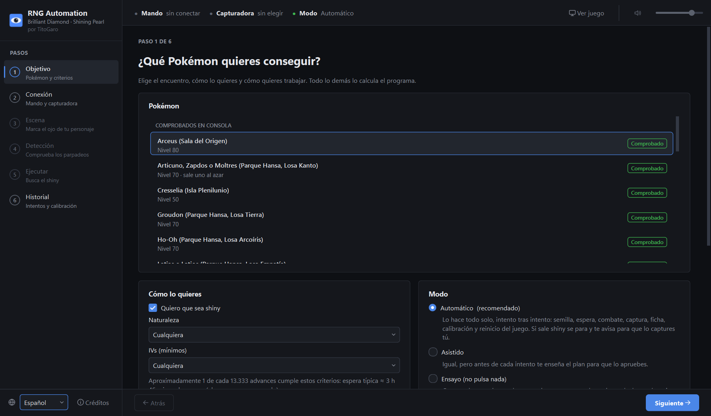

# RNG Automation para Pokémon Diamante Brillante y Perla Reluciente

Hecho por **TitoGaro** · [English](README.en.md)

[](https://buymeacoffee.com/titogaro)

Aplicación de escritorio para Windows que hace de principio a fin el RNG por parpadeos de los legendarios
estáticos de *Pokémon Diamante Brillante* y *Perla Reluciente*. Ve el juego por una capturadora y pulsa los
botones con un ESP32 que hace de mando.



En cada intento, el programa:

1. Observa los parpadeos de tu personaje y calcula el estado del generador de números aleatorios del juego
   (Xorshift128).
2. Busca el siguiente advance que da el Pokémon que has pedido (shiny, naturaleza, IVs).
3. Si la espera es larga, usa la Pokédex para adelantar el RNG y comprueba después dónde ha quedado.
4. Pulsa en el instante exacto y se acerca al legendario.
5. Mira si es shiny. Si lo es, se para y te deja la captura a ti. Si no, lo captura, lee su ficha, aprende
   del resultado y reinicia el juego para otro intento.

No modifica el juego ni la consola: la consola solo ve un mando.

## Encuentros

| Encuentro | Probado en una consola real |
|---|---|
| Regice, Regirock o Registeel (Parque Hansa, Losa Inicio) | Sí |
| Raikou, Entei o Suicune (Parque Hansa, Losa Johto) | Sí |
| Articuno, Zapdos o Moltres (Parque Hansa, Losa Kanto) | Sí |
| Latias o Latios (Parque Hansa, Losa Empatía) | Sí |
| Groudon, Kyogre, Ho-Oh, Lugia, Mewtwo, Rayquaza (Parque Hansa) | Sí |
| Regigigas (Templo Puntaneva) | Sí |
| Cresselia (Isla Plenilunio) | Sí |
| Arceus (Sala del Origen) | Sí |
| Dialga, Palkia (Columnas Lanza), Giratina, Heatran, Darkrai, Shaymin, Azelf, Uxie | Aún no |

La aplicación muestra primero los probados. Los no probados usan el mismo motor y están marcados: puede que
la primera vez haya que ajustar algo.

## Qué necesitas

- Un PC con Windows 10 u 11 y [Python](https://www.python.org/downloads/) 3.12 o posterior.
- Una Nintendo Switch con *Diamante Brillante* o *Perla Reluciente*.
- Una placa ESP32 con el firmware **PABotBase2** de
  [Pokémon Automation](https://github.com/PokemonAutomation). Sigue su
  [lista de mandos y guías de montaje](https://pokemonautomation.github.io/ControllerList.html) (la opción
  «ESP32») para elegir la placa, grabarla y emparejarla con la Switch. La aplicación está probada con el ESP32
  normal; también acepta un ESP32-S3, sin probar. El firmware no se incluye aquí y su licencia solo permite el
  uso no comercial.
- Una capturadora USB (mejor 1080p). La aplicación muestra la imagen y reproduce el sonido del juego: no
  hacen falta otros programas. Cierra cualquier otro programa que esté usando la capturadora.

## Descarga

1. Descarga el zip de la [última versión](https://github.com/TitoGaro/BlinkRNG-Automation/releases/latest) (en **Assets**).
2. Descomprímelo donde quieras y abre **`BlinkRNG-Automation.exe`**. No hace falta instalar Python.
3. La primera vez, Windows puede avisar con «Windows protegió su PC» porque el programa no está firmado: pulsa
   **Más información → Ejecutar de todos modos**.

Para ejecutarlo desde el código fuente, ver [Desarrollo](#desarrollo).

## Uso

La aplicación te guía en seis pasos:

| Paso | Qué haces |
|---|---|
| **1. Objetivo** | Eliges el Pokémon, lo que quieres de él (shiny, naturaleza, IVs) y el modo |
| **2. Conexión** | Enchufas el ESP32 y la capturadora. La aplicación los encuentra sola |
| **3. Escena** | Te colocas donde te indica y recuadras el ojo de tu personaje (una vez por encuentro) |
| **4. Detección** | Te quedas quieto un minuto o dos mientras comprueba que ve los parpadeos |
| **5. Ejecutar** | Pulsas **Empezar** y no tocas el mando |
| **6. Historial** | Intentos y lo que ha aprendido de tu montaje |

La guía completa, con lo que hay que preparar en la partida, está en
[`docs/03-guia-puesta-en-marcha.md`](docs/03-guia-puesta-en-marcha.md). Dónde guardar para cada legendario,
con capturas: [`docs/guia-encuentros.md`](docs/guia-encuentros.md).

La interfaz está en español y en inglés. La primera vez sigue el idioma de Windows; puedes cambiarlo abajo
en la barra lateral izquierda.

**Parada:** el botón rojo **Detener** de arriba (o la tecla `F12`) suelta todos los botones al instante.
El programa nunca guarda la partida, así que al reiniciar siempre vuelves a tu punto de guardado.

## Privacidad

Todo se ejecuta en tu PC. La aplicación no se conecta a internet ni recoge datos de uso. Guarda sus datos en
`%USERPROFILE%\.rngauto`: las plantillas del ojo, los ajustes, la calibración, los registros y grabaciones
cortas del ojo de tu personaje y de cada entrada en combate, que sirven para mejorar la detección. Puedes
borrar esa carpeta cuando quieras.

## Uso responsable

Úsalo en tu consola y con tu partida. El programa solo pulsa botones que podrías pulsar tú, pero automatizar
una consola puede ir contra las condiciones de uso de Nintendo: lo usas bajo tu responsabilidad.

## Desarrollo

```bash
git clone https://github.com/TitoGaro/BlinkRNG-Automation.git
cd BlinkRNG-Automation
py -m venv .venv
.venv\Scripts\python -m pip install -e .[dev]
```

Instálalo en modo editable (`-e`): los encuentros (`encounters/`) se leen de la carpeta del proyecto. Para abrir
la aplicación, doble clic en **`RNG Automation.bat`** o `.venv\Scripts\pythonw -m rngauto.gui.main`.

**Ejecutable:** `pip install -e .[build]` y `python -m PyInstaller packaging/rngauto.spec --noconfirm`. Cada
etiqueta `vX.Y.Z` subida a GitHub lo compila y lo publica en Releases automáticamente
(`.github/workflows/release.yml`).

### Herramientas de consola

El comando `rngauto` tiene herramientas para desarrollo y diagnóstico:

```bash
rngauto encounters                     # lista los encuentros configurados
rngauto targets --state "..." --pokemon dialga --shiny shiny   # busca objetivos desde un estado conocido
rngauto simulate --pokemon dialga      # ejecución completa contra una Switch simulada (sin hardware)
rngauto diagnose --serial COM3 --capture 1   # comprueba el ESP32 (sin pulsar nada) y la capturadora
```

`rngauto --help` muestra la lista completa.

### Tests

```bash
.venv\Scripts\python -m pytest
.venv\Scripts\python -m pytest -m "not slow"
```

Los tests marcados `local` necesitan grabaciones privadas o una copia local de PokeFinder y se omiten si no
están.

### Añadir un encuentro

Cada encuentro es un fichero TOML en `encounters/bdsp/`. Copia uno parecido (por ejemplo
`hansa_regice.toml`) y cambia la plantilla de generación, la escena de parpadeos, la ruta hasta el Pokémon y
el delay inicial. El motor no cambia. [`docs/01-arquitectura.md`](docs/01-arquitectura.md) explica cómo
encajan las piezas.

## Apoya el proyecto

RNG Automation es gratis y lo seguirá siendo. Si te ha servido y quieres apoyar su desarrollo, puedes
[invitarme a un café](https://buymeacoffee.com/titogaro). ¡Gracias!

## Agradecimientos

RNG Automation lo ha hecho **TitoGaro**, y no existiría sin quienes estudiaron estos juegos y compartieron lo
que descubrieron:

- **[Pokémon Automation](https://github.com/PokemonAutomation)**, Alexander J. Yee y todo el equipo y la
  comunidad de Pokémon Automation: el firmware y el protocolo PABotBase2, que convierten un microcontrolador
  en un mando, sus [guías de montaje](https://pokemonautomation.github.io/ControllerList.html) y las ideas de
  la detección de pantallas y de shinies.
- **[PokeFinder](https://github.com/Admiral-Fish/PokeFinder)**, de Admiral-Fish y sus colaboradores: la
  referencia de cómo genera BDSP los encuentros estáticos.
- **Project_Xs**, de [niart120](https://github.com/niart120/Project_Xs), y la
  [versión de Lincoln-LM](https://github.com/Lincoln-LM/Project_Xs): obtener el estado del RNG a partir de
  los parpadeos de tu personaje.
- **[PapaJefe](https://www.youtube.com/@PapaJefeYT)**, por sus vídeos de RNG de Pokémon.

Los detalles y los textos de las licencias están en [`THIRD_PARTY_NOTICES.md`](THIRD_PARTY_NOTICES.md).

## Licencia

Copyright © 2026 TitoGaro. Con licencia GPL-3.0-or-later: ver [`LICENSE`](LICENSE). El programa se ofrece
sin ninguna garantía.

Pokémon, Pokémon Diamante Brillante y Pokémon Perla Reluciente son marcas de Nintendo, Creatures Inc. y
GAME FREAK inc. Nintendo Switch es una marca de Nintendo. Es un proyecto no oficial de aficionados, sin
relación con ninguno de ellos ni respaldado por ellos.
