# Encounter guide

[Español](guia-encuentros.md)

Where to save for each legendary, what each screenshot shows and what you have to do. The program does the
rest (seed, waiting, route, presses, battle, catch and restart). For general use of the app, see the
[user guide](user-guide.md).

## First: what all of them have in common

**The save point is everything.** The program never saves: on every attempt it restarts the game and loads your
save, so everything always starts from the place and pose where you saved. Save exactly as shown in the
screenshots: in that spot and **facing the camera**, so your character's eye is visible.

**Professor Rowan's message.** Every screenshot shows the message where Professor Rowan's words echo in your
head ("There's a time and place for everything"). It appears when you use the fishing rod where you cannot fish.
With that message on screen your character stands still and does not turn their head, so the program sees the
blinks clearly. You do not need to bring it up yourself: the program uses the rod. The screenshots show what the
screen looks like while it watches.

**Save file requirements** (details in the [user guide](user-guide.md#before-you-start-once)):

- a party of **5** Pokémon, so the caught one goes into the 6th slot;
- at least one **Master Ball** in the Bag (since the program never saves, the one it uses comes back on restart);
- the **fishing rod registered** on the "+" wheel (you choose its direction in the "Scene" step);
- in the game options, fast text speed and nicknaming turned off.

**The eye is marked once per encounter** in the "Scene" step: load the save, freeze the picture, draw a box
around the eye and save it. Some encounters need a **second eye** in front of the legendary: this is noted for
each one.

## Ramanas Park

The Regis, the legendary beasts of Johto, the Kanto birds, Latias and Latios, Groudon, Kyogre, Ho-Oh, Lugia,
Mewtwo and Rayquaza. They all work the same way and are **verified on a console**.

**Where to save:** in the room of each slate, **in front of the pedestal, facing the camera** (with your back to
the pedestal). You need the matching slate in your Bag: since the program never saves, your save keeps it.

**What the program does:** it watches the blinks, works out the timing, then turns to the pedestal, places the
slate, presses at the exact moment to enter the legendary's room, walks up to it and talks to it. When the battle
starts it checks for a shiny: if it is one, it stops and you catch it yourself; if not, it catches it, reads its
Summary and restarts for another attempt.

**What you do:** save in the right spot, mark the eye once and press "Start".

| Encounter | Game | Save point screenshot |
|---|---|---|
| **Regice, Regirock or Registeel**: Discovery Room, Discovery Slate. One of the three at random | Both | 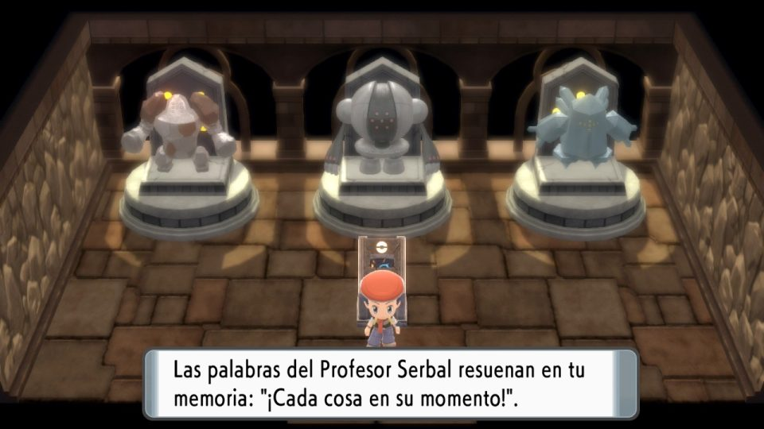 |
| **Raikou, Entei or Suicune**: Johto Room, Johto Slate. One of the three at random | Both | 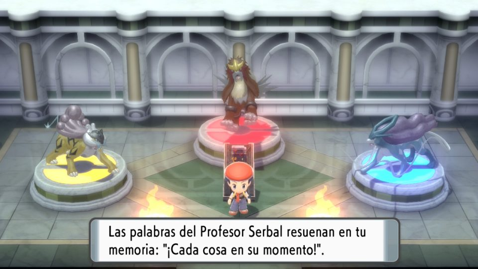 |
| **Latias or Latios**: Soul Room, Soul Slate. One of the two at random | Both | 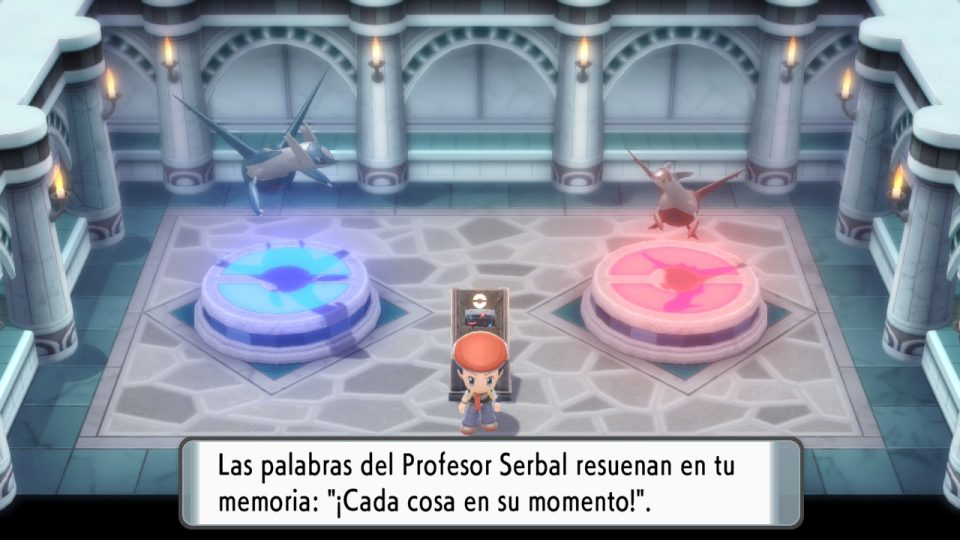 |
| **Groudon**: Tectonic Room, Tectonic Slate | Brilliant Diamond | 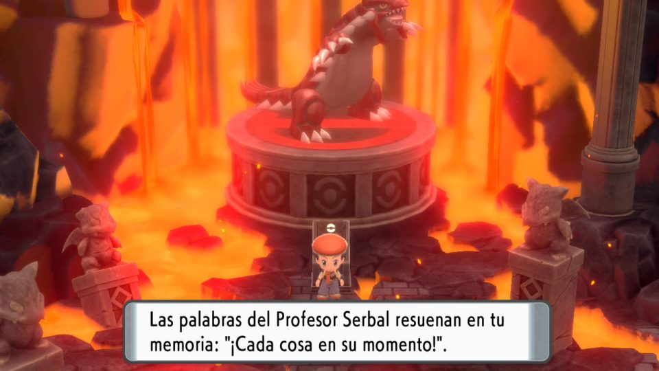 |
| **Kyogre**: Oceanic Room, Oceanic Slate | Shining Pearl | 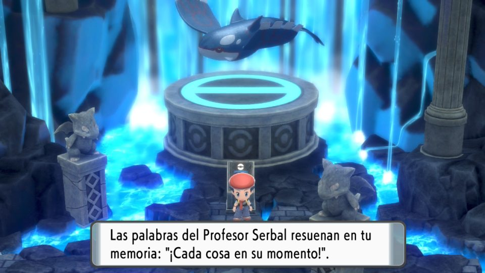 |
| **Ho-Oh**: Rainbow Room, Rainbow Slate | Brilliant Diamond | 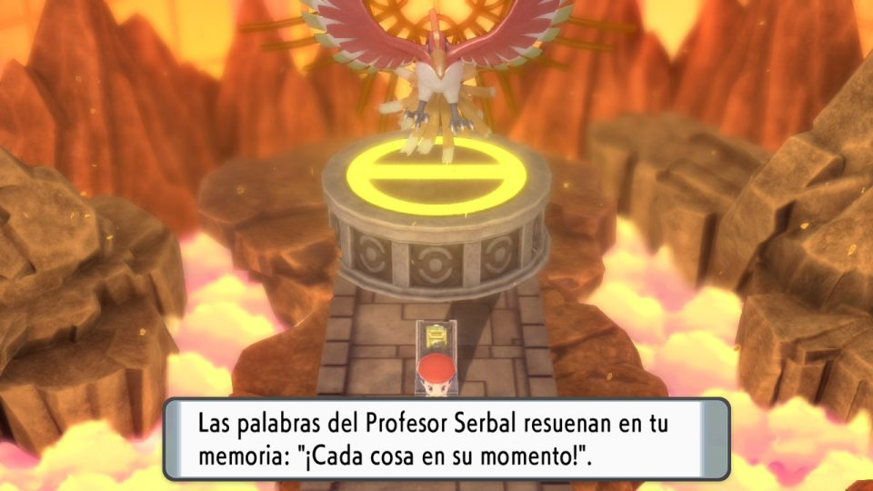 |
| **Mewtwo**: Genome Room, Genome Slate | Both | 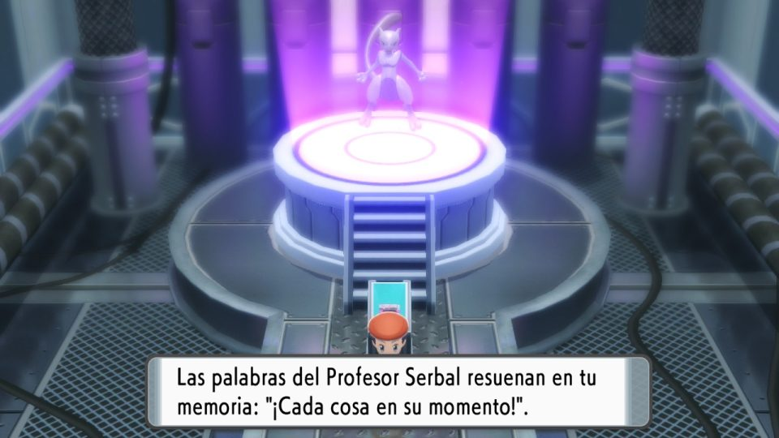 |
| **Rayquaza**: Stratospheric Room, Stratospheric Slate | Both | 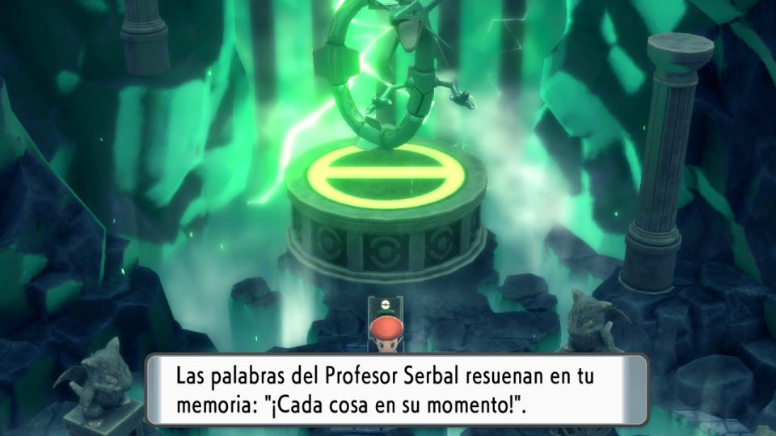 |
| **Articuno, Zapdos or Moltres**: Kanto Room, Kanto Slate. One of the three at random | Both | Same as the others: in front of the pedestal, facing the camera |
| **Lugia**: Squall Room, Squall Slate | Shining Pearl | Same as the others: in front of the pedestal, facing the camera |

## Regigigas (Snowpoint Temple)

Verified on a console.

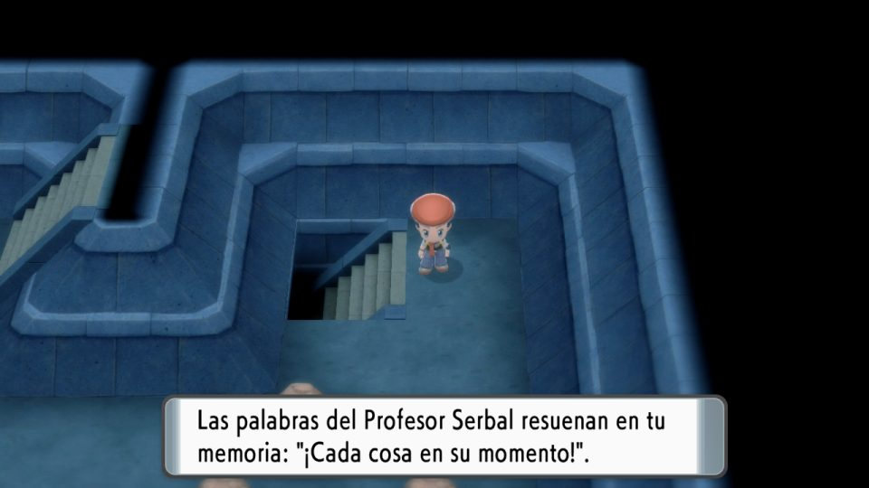

**Where to save:** on the upper floor of the temple, **in front of the stairs that lead down to Regigigas's
room**, facing the camera. Have **Regirock, Regice and Registeel** in your party: without them, Regigigas does
not wake up.

**Why there:** in its room, Regigigas's own blinks also use up RNG and the seed could not be worked out. Upstairs
it is not loaded and the seed comes out clean.

**What the program does:** it gets the seed upstairs, goes down, solves the ice puzzle up to Regigigas (~47 s),
stands in front of it and re-syncs taking its blinks into account. Then it talks to it at the exact moment.

**What you do:** this encounter needs **two eyes**. In the "Scene" step:

1. **Upstairs eye:** load the save, bring up the message with the rod, freeze the picture, mark the eye and save
   it.
2. **Eye in front of Regigigas:** **without saving**, go down and solve the puzzle up to Regigigas, stand right
   below it facing the camera (one tap of D-pad Down), bring up the message with the rod and mark this second eye.
   Then reload your save (do not save there).

## Arceus (Hall of Origin)

Verified on a console.

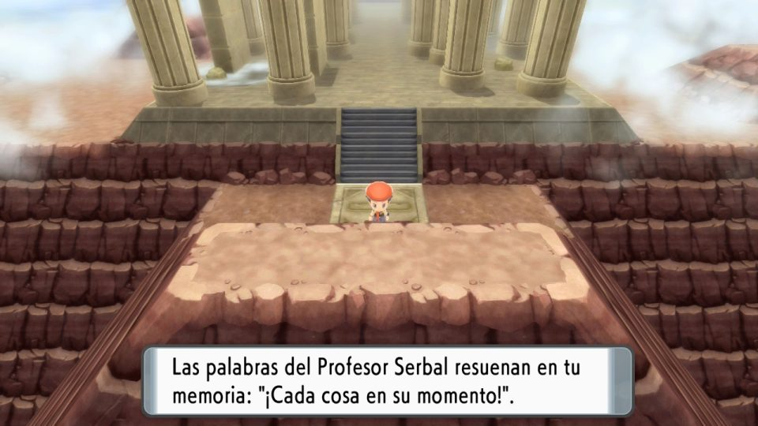

**Where to save:** at the top of Spear Pillar, **one step away from the tile** where the flute is played, facing
the camera. You need the **Azure Flute**.

**What the program does:** it gets the seed, steps onto the tile, plays the flute, waits for the cutscene
(~42 s), climbs the stairs to Arceus (~36 s) and talks to it at the exact moment. The whole route takes about
85 s.

**What you do:** save in the right spot, mark the eye once and press "Start".

## Cresselia (Fullmoon Island)

Verified on a console. It is the longest encounter and the only one where **you do the catching**: Cresselia
does not start a battle when you talk to it; it flies away and roams Sinnoh.

**Requirement:** the island event must be active. The sailor on the Canalave City pier offers to take you to
Fullmoon Island to find the Lunar Feather that will cure his son's nightmares. Save **before** going to the
island and before seeing Cresselia.

### Where to save

The seed cannot be worked out on the island: Cresselia is loaded from the moment you reach the pier, and its
blinks use up RNG at random intervals. That is why the seed is taken somewhere quiet in Canalave City: the empty
house just north of the sailor's pier (marked in red):

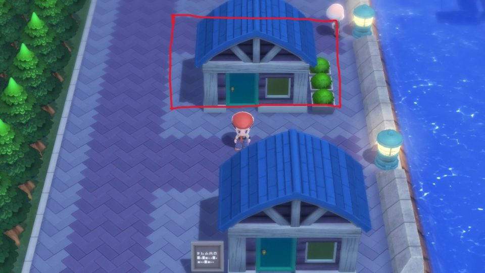

Go into the house and stand **on the edge of the rug, two tiles above the door, facing the camera**. One tile
lower and you leave the house when you turn, and the route fails. Save there:

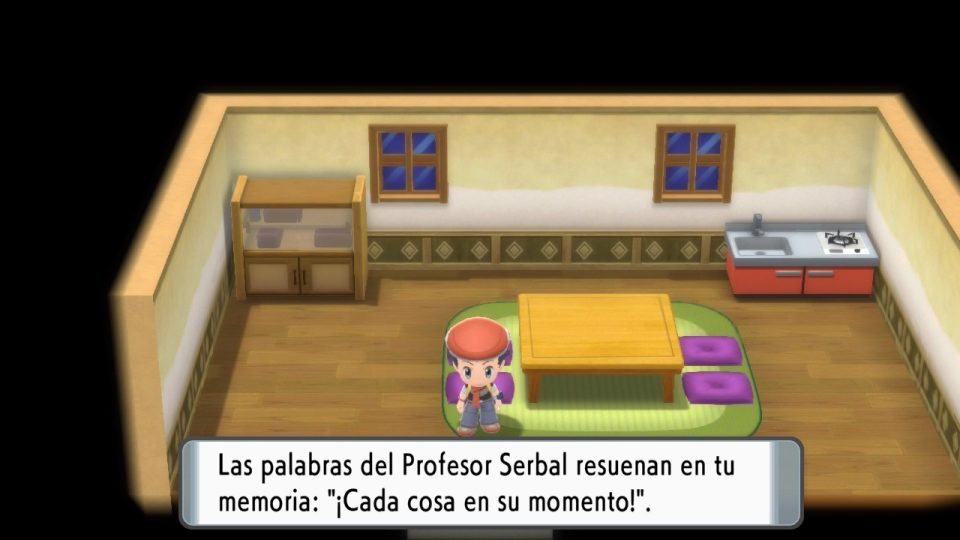

### The two eyes ("Scene" step)

1. **House eye:** load the save, bring up the message with the rod, freeze the picture, mark the eye and save it.
2. **Eye in front of Cresselia:** **without saving**, make the trip yourself: leave the house, talk to the sailor,
   take the boat and walk across the island to Cresselia. Stand right below it facing the camera (one tap of
   D-pad Down), bring up the message with the rod and mark this second eye. Then reload your save (do not save
   there).

### What the program does

1. It gets the seed in the house (about 4-6 minutes) and works out when to talk to Cresselia.
2. It leaves the house, goes along the right of the houses to the pier and talks to the sailor (if it does not
   reach him the first time, it turns towards him and tries again).
3. It answers "Yes", goes through the text and waits for the boat trip.
4. It walks across the island to Cresselia (the whole route takes about 2 minutes).
5. In front of it, it re-syncs using both your blinks and Cresselia's (2-3 minutes). The boat and the people of
   Canalave City shift the counter a lot, so this step is essential. If the target is still far away, it uses the
   Pokédex right there and repeats.
6. It talks to Cresselia at the exact moment. Cresselia is generated then and flies away.

### What you do afterwards

1. The app shows "Your turn: catch Cresselia and press "Ready"". **Do not save the game.**
2. Find Cresselia somewhere in Sinnoh and catch it. With a party of 5 it goes into the 6th slot. If you use the
   Master Ball, that is fine: it comes back on restart.
3. Let go of the controller and press **"Ready"**.
4. The app asks **"Is Cresselia SHINY?"**:
   - **Yes:** the program stops without touching the controller. Save the game.
   - **No:** the program opens its Summary, reads its nature and stats to refine the calibration and restarts
     the game for another attempt.

If you close that question without answering, the program stops without touching anything: it never risks a
possible shiny.

## Not tested yet

These use the same mechanism but have not been verified on a console yet. Run a **Dry run** session first: it
checks detection and planning without pressing anything.

### Azelf (Lake Valor)

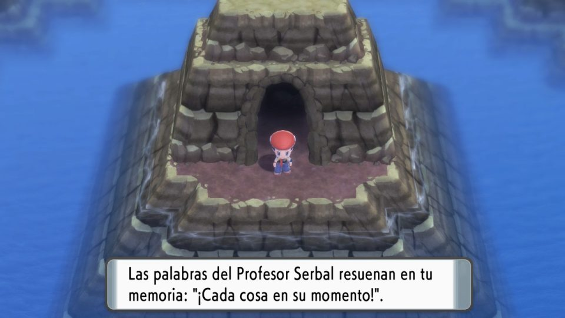

**Where to save:** outside Valor Cavern, **right in front of the entrance, facing the camera**. Inside the cave
Azelf is already loaded and the seed would not come out clean.

**What the program does:** it turns around, enters the cave, walks up to Azelf and talks to it at the exact
moment.

### Uxie (Lake Acuity)

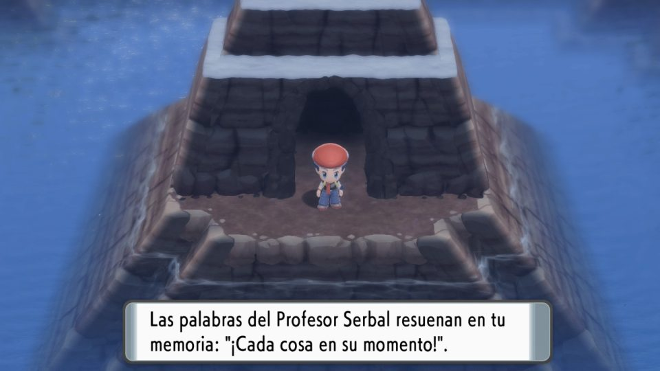

**Where to save:** outside Acuity Cavern, **right in front of the entrance, facing the camera**.

**What the program does:** same as Azelf: it turns around, goes in, walks about 10 steps up to Uxie and talks to
it.

### Others

Dialga, Palkia, Giratina, Heatran, Darkrai and Shaymin do not have a guide yet. The instructions for each one
appear in the "Scene" step of the app.
